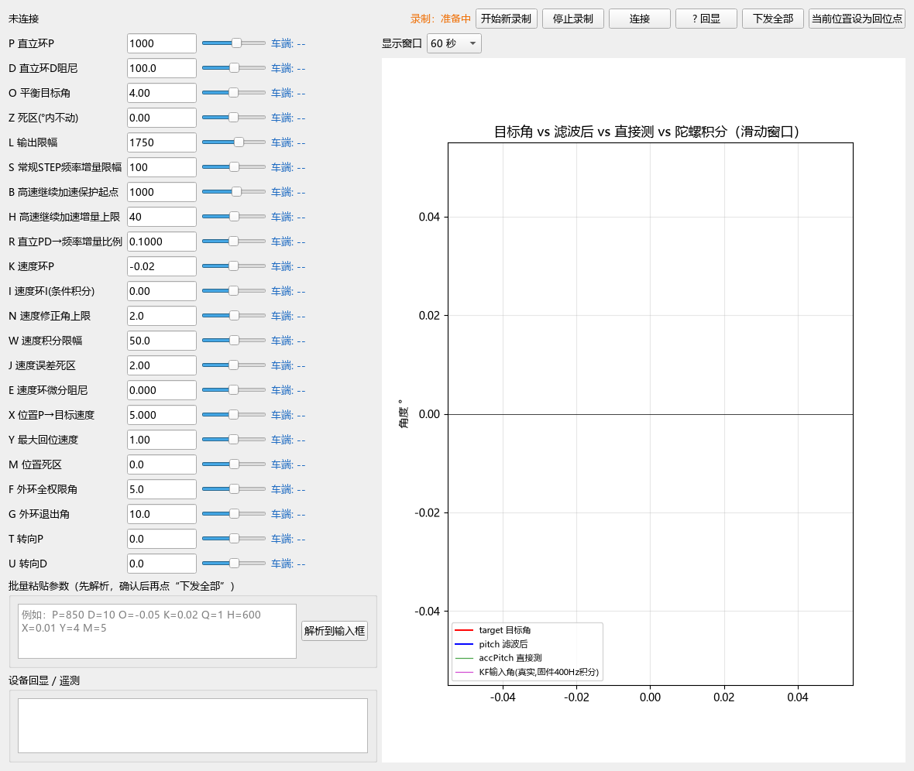
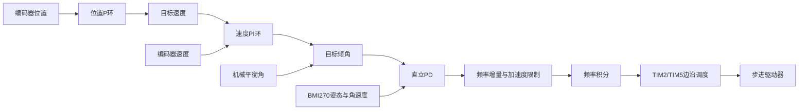

# STM32F407ZG 步进电机平衡车

## 简介

本项目实现了一套基于 STM32F407ZG 的步进电机平衡车控制系统，使用 BMI270 与编码器获取姿态和运动反馈，通过 STEP/DIR 控制步进驱动器，并配套电脑端蓝牙调参、曲线显示与数据记录工具。

当前工程采用“位置环 → 速度环 → 目标倾角 → 直立 PD → 频率增量积分”的控制结构，包含加速度限制、换向软过渡及非阻塞通信。当前源码已通过独立构建和主机逻辑回归；精确位置保持与物理输出波形仍在完善。

## 硬件组成

| 模块 | 当前工程配置 |
| --- | --- |
| 主控制器 | STM32F407ZG，PlatformIO环境black_f407zg |
| 惯性测量 | BMI270，I2C接口 |
| 电机系统 | 双步进电机，STEP/DIR接口 |
| 驱动集成 | MKS TMC2209独立STEP/DIR配置；板件及细分按实际装配核对 |
| 运动反馈 | 两路AB相编码器及可信通道选路 |
| 无线调参 | JDY-23 BLE模块，USART3 |
| 电路设计 | 嘉立创EDA源工程 |
| 机械结构 | SolidWorks装配体、零件源文件及STL |

主程序接口和引脚见[系统设计说明](docs/system-overview.md)。驱动模式、电流和细分由实际载板硬件决定，固件不依赖UART读回启动。当前归集源文件的板卡日期不等同于已完成最终电气审查。

## 软件开发环境

| 用途 | 环境与工具 |
| --- | --- |
| 固件 | PlatformIO + ststm32 + Arduino framework |
| 构建环境 | black_f407zg；当前验证平台ststm32 19.7.0 |
| 传感器库 | SparkFun BMI270 Arduino Library 1.0.3 |
| 驱动诊断依赖 | TMCStepper 0.7.3，独立模式主链不启用UART配置 |
| 上位机 | Python 3.11、PyQt5、bleak、matplotlib |
| 电路 / 机械 | 嘉立创EDA / SolidWorks |

## 运行与界面

### 蓝牙调参面板

面板支持参数设置、车端回显、姿态曲线和CSV录制。下图为当前程序的离线界面，不包含实车连接或试验波形。



Windows双击仓库根目录 `open-panel.bat` 启动。新录制写入 `docs/validation/recordings/`，不会混入既有历史数据。

### 当前版本验证

| 项目 | 状态 |
| --- | --- |
| 固件独立构建 | 通过；RAM 7904 B、Flash 77400 B |
| 主机运动逻辑回归 | 通过 |
| 面板依赖、界面与默认参数核对 | 通过；离线检查 |
| 当前默认参数下的统一实车测试 | 待补充 |
| 精确位置保持 | 待完善 |
| 电气 / 机械源工程完整性 | 待专用软件复核 |

当前版本实车视频与波形尚未独立归档。过往稳定片段、旧参数试验和早期视频保存在 `history/`，不作为当前版本验证。[详细状态](docs/validation/README.md)

## 控制系统



设计周期为2.5ms，速度与位置目标计算约100Hz；STEP使用定时器中断驱动PA6/PA8 GPIO边沿。[系统与引脚](docs/system-overview.md) · [默认参数](docs/parameters.md)

## 电路与机械设计

- [原理图源工程](hardware/schematic/v2026-09-23/)
- [PCB源工程](hardware/pcb/v2026-09-23/)
- [SolidWorks源文件状态说明](mechanical/cad/)
- [STL打印文件](mechanical/printable/)

BOM、生产文件和加工图仍待补齐。装配体外部引用需由SolidWorks打开核对；尚未以文件存在替代电气或机械审查。

## 工程结构

```text
├─ software/               当前软件
│  ├─ firmware/            PlatformIO主固件及主机回归
│  ├─ ble-panel/           当前蓝牙调参面板
│  └─ analysis/            保留维护的数据分析工具
├─ hardware/               原理图、PCB及后续生产资料
├─ mechanical/             装配体、零件和打印文件
├─ docs/                   当前版本说明、参数、界面与验证
├─ history/                过往报告、日志、旧程序、试验和视频
├─ GETTING_STARTED.md      构建与运行说明
├─ build-firmware.bat      Windows编译入口
└─ open-panel.bat          Windows面板入口
```

## 快速开始

```powershell
cd software/firmware
pio run -e black_f407zg
```

需要烧录时使用 `pio run -e black_f407zg -t upload`。面板安装与连接见[运行说明](GETTING_STARTED.md)。

## 开发记录与后续计划

历史资料统一从[history入口](history/README.md)查阅，首页仅展示当前实现。

后续重点：统一单路/双路编码器的位置尺度，完善位置保持；采集当前版本实车视频和STEP/DIR波形；补齐BOM、装配依赖及版本化测试条件。软件构建通过不等于已验证所有实车工况。

## 资料与许可

许可证尚未确定。运行环境、构建缓存、本机设备地址及离线厂商PDF不进入Git。旧汇报PPT、早期视频与SolidWorks源文件仅保留在本机，待完成内容及内部元数据审查后再发布；已提供STL文件。第三方材料来源见[参考资料](docs/references/README.md)。

页面组织参考[两轮差速平衡小车项目](https://github.com/zhangming-wang/twoWheelBalanceCar)，仅借鉴展示结构，未复制其程序、图片或许可证。
