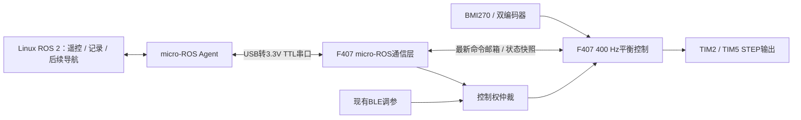

# 平衡车 ROS 2 / micro-ROS 接入调研

日期：2026-10-29（Asia/Shanghai）。范围：当前源码审查与官方资料核对；未安装依赖、未修改或烧录固件、未验证实车通信。

## 1. 结论与建议

当前 STM32F407ZG 可以作为 micro-ROS 的移植目标，现有项目不能视为已经获得即插即用支持。推荐结构：F407 自主执行姿态估计、400 Hz 平衡控制和 STEP 输出；Linux 上位机运行 ROS 2、micro-ROS Agent、遥控与后续导航。ROS 下发运动目标，不承载直立闭环。

建议先在当前 PlatformIO/Arduino 工程体系做独立、架空且电机禁能的最小通信验证，确认 black_f407zg 的编译、串口和内存适配；正式并行运行控制与通信时，优先评估 CubeMX + FreeRTOS + UART DMA。不要同时改控制算法和通信框架。

如果目的只是先让 ROS 遥控、记录数据，也可以暂用 Linux ROS 2 串口桥接现有协议；这不是 micro-ROS，但可先验证指令单位、控制权与断线逻辑。用户若要求 MCU 直接成为 ROS 2 节点，则继续下面的 micro-ROS 路线。

## 2. 当前工程事实

总库入口：`D:\AI项目总库\02_机器人与机械工程\PlatformIO项目\pinghengche\balance-car-showcase`。该总库入口映射到原 PlatformIO 目录，是同一份工程，不另建副本。

| 项目 | 源码/本地文档事实 | 对接含义 |
| --- | --- | --- |
| 主控/框架 | STM32F407ZG，black_f407zg，ststm32 + Arduino | 不能使用 ESP32 的 Wi-Fi 接入步骤代替板级适配 |
| 控制时序 | CONTROL_PERIOD_US=2500，设计400 Hz；主 loop 通过 micros 调度 | 目前不是独立高优先级控制任务 |
| 超时行为 | controlGapUs >= 5000 时记录 overrun、停止电机、清控制输出 | 不能把10～100 ms的通信等待塞进 loop |
| STEP | TIM2/TIM5 中断调度 PA6/PA8 GPIO | RTOS/HAL迁移必须保留并核对中断与定时器资源 |
| 传感器 | BMI270，PB8/PB9 I2C | 保留采样；通信层读取快照，不重复访问 I2C |
| 编码器 | PA0/PA1、PB6/PB7；源码记录过第二路间歇无计数 | 可靠双轮里程计之前需排查编码器、统一尺度 |
| 蓝牙 | JDY-23，USART3 PB10/PB11，9600 baud | 保留调参；不要在同一串口混发 XRCE 与文本 |
| 驱动 | 当前 TMC_STANDALONE_STEP_DIR=1 | USART1/2旧TMC实验代码不参与当前主链，但物理连线仍需核对 |
| 运动接口 | manualForward、manualTurn；原子文本帧 @ turnHz,forwardSpeed | 可复用目标限幅、斜坡、超时与位置保持旁路 |
| 通信保护 | 350 ms命令过期后目标回零；有needsZero联锁 | 回零含减速过程，不等于立即物理停车 |
| 单位 | 前后 count/50ms；转向每轮差速STEP Hz | 接ROS前要做物理单位、极性标定 |
| 当前资源记录 | 文档记录RAM7948 B、Flash79920 B | 这是原固件构建结果，不是加micro-ROS后的资源保证 |

核对文件：software/firmware/platformio.ini、src/main.cpp、src/manual_motion.h、src/manual_turn.h；docs/system-overview.md、docs/turning.md。工作区已有未提交的运动功能修改，本文不覆盖这些修改。未在本工程及核查的父级找到 RTK.md，因此没有将其作为已读取的规则依据。

## 3. 官方支持与选型

官方 PlatformIO 库列有 Arduino 下的 olimex_e407，未列 black_f407zg。它是相近 STM32 参考，不能直接把板名改成 olimex_e407：时钟、引脚、启动和链接配置仍应服从实际板卡。[官方支持表](https://github.com/micro-ROS/micro_ros_platformio/blob/main/README.md)

进一步检查官方 extra_script.py：未知板会回退到 colcon.meta，并非“列表没有就拒绝编译”。所以 black_f407zg 保持原配置做试编有依据；是否成功取决于交叉编译参数、Arduino串口/时间实现及内存链接，本文尚未验证。[构建脚本](https://github.com/micro-ROS/micro_ros_platformio/blob/main/extra_script.py)

| 路线 | 改动与收益 | 选择建议 |
| --- | --- | --- |
| 原PlatformIO + micro_ros_platformio | 保留BMI270、STEP与现有代码；需验证目标板和通信耗时 | 最小概念验证先选它；通过编译不等于满足控制时序 |
| CubeMX + FreeRTOS + 官方STM32工具 | UART DMA、独立任务更方便；须迁移传感器、定时器和控制调度 | 正式融合控制与micro-ROS的推荐路线，迁移量较大 |
| 原协议 + Linux ROS 2桥接 | 固件改动小，能先打通上层工具 | 快速验证备选；不是MCU原生micro-ROS |

建议新建环境采用 Ubuntu 24.04 + ROS 2 Jazzy；REP-2000列出该组合及Jazzy支持到2029年5月。如果已有可用 Ubuntu 22.04/Humble 环境，可先沿用并把两端版本统一。Jazzy是本项目兼容性选择，不代表它是当前最新ROS版本。[ROS平台与版本政策](https://github.com/ros-infrastructure/rep/blob/master/rep-2000.rst)

## 4. 系统拓扑与接线



首次使用独立 UART + USB-TTL。USART2 的 PA2(TX)/PA3(RX)是候选，不是已经确认空闲的PCB接口；需要查原理图、连接器和实车，尤其旧TMC的PA2单线。USART1 PA9/PA10同样存在历史驱动用途，不能默认空闲。USART3已由BLE占用。

接线：STM32 TX → 转接器RX，STM32 RX ← 转接器TX，共GND；选择3.3V逻辑。保持现有车端供电方式，核对转接器电源脚是否需要连接。ST-Link继续负责下载调试；是否附带虚拟串口取决于具体硬件，不能默认可用。

先115200 baud、低频小消息验证。8N1下有效串口上限约11520字节/s；完整Imu消息含多个float64数组，数百字节/帧，50 Hz可能超过该预算。后续可试460800并测误码/丢包，或保留低发布频率、发送紧凑数据在上位机转换。USB CDC可作后续选项，需确认USB口接法、时钟和固件支持。JDY-23 BLE不是本项目首选micro-ROS传输。

## 5. Linux端搭建步骤

以下是待执行步骤，不代表当前电脑已有这些环境。优先原生Ubuntu或已有Ubuntu虚拟机；虚拟机需把USB-TTL交给Ubuntu并在其中确认/dev/ttyUSB*。WSL需要额外USB透传配置，不能直接使用Windows COM号当作Linux设备名。

先按官方ROS安装说明完成Jazzy并确认 `ros2 --help`；项目上位机工作区放在所属项目的software/ros2目录。Linux内访问总库时，应使用对应挂载路径。下面假定终端已经进入该目录，不在用户主目录创建另一个项目。

```bash
# Ubuntu 24.04，已有Jazzy和ROS开发工具；当前目录为项目software/ros2
source /opt/ros/jazzy/setup.bash
sudo apt update
sudo apt install -y git cmake python3-pip python3-colcon-common-extensions python3-rosdep
mkdir -p agent_ws/src
cd agent_ws
git clone -b jazzy https://github.com/micro-ROS/micro_ros_setup.git src/micro_ros_setup
# 如本机从未初始化rosdep，先执行一次 sudo rosdep init
rosdep update
rosdep install --from-paths src --ignore-src -y
colcon build
source install/local_setup.bash
ros2 run micro_ros_setup create_agent_ws.sh
ros2 run micro_ros_setup build_agent.sh
source install/local_setup.bash
# ttyUSB0只是示例，使用本机实际设备；波特率与固件一致
ros2 run micro_ros_agent micro_ros_agent serial --dev /dev/ttyUSB0 -b 115200 -v6
```

上述Agent构建流程来自官方setup工具。串口权限不够时把当前用户加入dialout并重新登录；关闭占用该口的串口监视器。每个ROS终端加载同一发行版环境，统一ROS_DOMAIN_ID。[Agent构建入口](https://github.com/micro-ROS/micro_ros_setup/tree/jazzy#building-micro-ros-agent)

## 6. 保留PlatformIO的最小验证

在原platformio.ini新增独立环境，保留原环境。下面仅是候选配置，尚未执行构建，不能标记为可直接烧录版本。若基础环境以后增加特殊build_flags，应同步继承。

```ini
[env:black_f407zg_microros]
extends = env:black_f407zg
board_microros_distro = jazzy
board_microros_transport = serial
lib_deps =
    ${env:black_f407zg.lib_deps}
    https://github.com/micro-ROS/micro_ros_platformio
```

首次成功后固定库的已验证commit，避免main变化。使用干净、可复现的Linux构建环境优先验证；官方构建脚本使用penv/bin/activate等路径，不能因为原Windows固件能编译，就推断micro-ROS内部构建也能通过。中文路径已有工具兼容问题，应使用指向同一工程的既有物理路径或对应Linux挂载，不能复制工程产生分叉。

验证顺序：先关闭电机输出，在独立测试入口中用指定HardwareSerial建立micro-ROS串口；创建balance_base节点、一个计数发布器和一个小消息订阅器；再加入只读状态快照。串口上只传XRCE数据，日志仍走BLE或SWD。该阶段不接收运动控制。

应检查完整编译日志、map文件、静态RAM、实际堆与栈余量，不能只引用PlatformIO显示的原始RAM统计。静态库必须与工程的Cortex-M4、Thumb、FPU与float ABI配置一致。

## 7. 正式实时架构

现有控制在loop里，STEP虽有定时器中断，IMU和直立计算仍会被loop内阻塞拖延。官方serial传输调用Stream::write/readBytes，read会使用传入timeout；需实测最长阻塞。[串口传输源码](https://github.com/micro-ROS/micro_ros_platformio/blob/main/platform_code/arduino/serial/micro_ros_transport.cpp)

推荐任务分工（设计建议）：

- 高优先级控制任务：硬件定时器以400 Hz通知，读取IMU/编码器、更新控制与电机；不调用rcl、日志格式化、动态分配、Agent握手。
- 低优先级通信任务：串口接收、rclc执行、遥测发布、连接状态机；通过固定大小邮箱提交“最新目标”，通过双缓冲读取遥测。
- STEP ISR保持短小，保留TIM2/TIM5资源；定时通知ISR不执行阻塞I2C或ROS；FreeRTOS API调用的中断优先级遵循端口限制。
- BLE与ROS之间有显式控制源/所有权，禁止两边最后写入者随机抢控制。切换源先回零并重新授权；通信重连不自动恢复旧的运动目标。

`rclc_executor_spin_some(...,0)`只取消等待，并不限制全部回调和底层传输的总耗时；不能据此宣称2.5ms闭环有保证。[rclc维护者对timeout的说明](https://github.com/ros2/rclc/issues/399)

CubeMX路线中，按实际F407ZG建工程，核对外部晶振/时钟；配置FreeRTOS与UART DMA，RX Circular，启用相应UART中断；使用jazzy分支的micro_ros_stm32cubemx_utils生成并链接静态库，再迁入控制模块。STM32工具要求micro-ROS任务栈大于10kB；可从16kB起测并检查水位，具体预算以链接与运行测量为准。F407 DMA缓冲要位于DMA可访问SRAM，不要误放CCM。先迁移并验证原控制，再启用ROS通信。[官方STM32集成说明](https://github.com/micro-ROS/micro_ros_stm32cubemx_utils/tree/jazzy)

## 8. ROS接口与单位转换

第一阶段控制建议20 Hz发命令，遥测先5～10 Hz；这是初始设计频率，不是实测容量。

| Topic | 类型/方向 | 用途 |
| --- | --- | --- |
| /cmd_vel | geometry_msgs/msg/Twist，订阅 | linear.x(m/s)、angular.z(rad/s)，先经过上位机命令仲裁与超时 |
| /imu/data_raw | sensor_msgs/msg/Imu，发布 | 三轴角速度rad/s、加速度m/s²；没有完整姿态时orientation_covariance[0]=-1 |
| /balance/status | 初期用标准小消息，后续自定义定长结构，发布 | 倾角、限幅、跌倒、编码器可信状态、控制耗时、overrun |
| /wheel_states | 标定后sensor_msgs/msg/JointState，发布 | 双轮角度rad、角速度rad/s；提前分配字符串与数组 |
| /odom、/tf | 上位机计算 | 首期不要让MCU承担全套里程计与TF发布 |

令r为轮半径(m)，C为“现有实际计数方式下每轮一圈的计数”，S为每轮转一圈所需STEP脉冲数，b为两轮中心距(m)：

- 前后目标换算：`forward_count_per_50ms = v * C * 0.05 / (2*pi*r)`，再服从现有±8限制；不能擅自加大量程。
- 理想滚动下每轮转向差速大小：`turnHz = omega * b * S / (4*pi*r)`；按现有±300Hz、平衡输出剩余空间和倾角权限限幅。
- 两个公式都需要实测符号。现有motor1/2与左右轮的映射也要实测；不能从引脚或旧“前后轮”注释推定ROS左转正方向。
- C取实际ISR计数结果，不照搬编码器标称PPR；S核对驱动器实际细分和传动比。优先实测每米计数、每圈脉冲，并做定距离/定角度验证。

当前转向是开环差速频率，尚不是闭环角速度控制；可接受Twist目标不代表已具备导航精度。仅一路编码器可信时不能发布可信的完整双轮差速里程计。先修复第二路、统一位置/速度尺度，再考虑导航。

IMU原代码的角度/轴方向不能原样塞进ROS标准消息：度转rad、g转m/s²、按实际安装转换到x前/y左/z上的约定。单轴pitch估计不构成可靠完整四元数；BMI270六轴也不提供绝对航向。时间戳来自测量时刻，连接后在通信任务同步Agent时间；控制dt继续使用本地单调时钟，不随ROS时间校准变化。

## 9. 断线、重连与控制保护

通信层采用WAITING_AGENT → CREATE → CONNECTED → DESTROY/WAITING状态机；连接失败不停止本地平衡调度。官方示例的ping和spin为100ms，且提示实体创建/销毁可能耗时数秒，因此只能借鉴状态，不直接复制到当前loop。[官方重连示例](https://github.com/micro-ROS/micro_ros_arduino/blob/jazzy/examples/micro-ros_reconnection_example/micro-ros_reconnection_example.ino)

ROS命令不新鲜时撤回前后与转向目标，继续既有平衡与减速逻辑；只有本地倾倒、IMU故障等保护负责电机禁能。保留现有350ms超时和needsZero零命令解锁。Agent恢复后清空旧目标，要求新的零指令/控制权再允许移动。

若上位机中转cmd_vel，必须追踪原始输入的新鲜度；不能无限重复最后一条非零Twist，让MCU的350ms计时被不断续期。命令队列只保留最新值，重连丢弃历史运动队列；需要时使用带时间戳/序号的内部命令。遥测优先best-effort，命令明确QoS和队列深度并实测兼容；可靠传输不能替代过期判定。

## 10. 分阶段验收与下一步

1. **原控制基线**：记录当前软件版本、参数和烧录状态。实测controlMaxGapUs、控制工作耗时、overrun增量和STEP波形，不把已有离线回归当作实车证明。
2. **micro-ROS通信验证**：电机禁能；完成编译、串口Agent发现、发布/订阅、100次断连重连及资源水位记录。排除堆泄漏与失败半初始化。
3. **只读接入控制**：启用本地控制，低频发布状态，注入Agent缺失、重启、串口拥堵；控制间隔必须不触发既有5ms保护，且留有测得的2.5ms预算余量。记录最大值，不能只看平均值。
4. **运动指令**：架空核对正负与两轮映射，再落地低速；验证零命令、350ms过期、上游发布器退出、BLE/ROS切换和重连不自走。实测物理停稳时间，不能把350ms当停车距离保证。
5. **标定与上层功能**：测轮径/轮距/计数，修复编码器；再发布odom、建TF并做RViz/rosbag。SLAM/Nav2另需合适环境传感器、定位和可靠运动闭环，micro-ROS本身不会补齐这些能力。

最先值得执行的工作：建立不驱动电机的black_f407zg最小micro-ROS串口验证，得到“能编译、能发现、资源够、连接可恢复”的证据；随后再决定原框架是否能满足时序，或进入FreeRTOS迁移。当前任务到调研为止，没有执行上述安装、构建与试车。

## 11. 车载ROS主机与视觉选型补充（2026-10-29）

用户补充：总预算最多2000元，希望接点云与相机；已有另一台车上的激光雷达，没有深度相机。雷达型号、2D/3D、接口与能否长期借用尚未确认。以下预算按可复用现有雷达、新增普通RGB相机规划；金额为采购控制额度，不是已经核实的商家实时报价。

### 是否需要ESP32

不必增加。电脑运行ROS时，STM32+现有BLE可完成目标下发和低频反馈；车上要独立运行完整ROS 2，需要Linux上位机。ESP32可作无线桥接或micro-ROS节点，但不能替代用于ROS、相机和点云算法的Linux计算板。

车载推荐拓扑：USB相机、雷达接Linux板；Linux运行传感器驱动、定位/规划，串口向STM32发送运动目标；STM32继续400Hz平衡与电机控制。Linux与STM32同车用短UART或USB转UART，BLE保留调参；无线网络用于电脑监看。大量图像与点云不经过JDY-23。

### 配置分档（工程建议，不是ROS软件硬性最低要求）

- 仅驱动、遥控、少量状态处理：现代64位ARM四核、4GB RAM、32～64GB存储即可作为起点；不代表能运行任意SLAM。
- 当前雷达+相机目标：建议8GB RAM、64GB系统存储起步，USB3与适合雷达的网络/USB接口、主动散热；频繁录制数据优先128GB及以上SSD。
- 稠密RGB-D建图、高频3D雷达、视觉惯导或多模型同时运行：按实际数据回放测负载；8/16GB ARM板都不能仅凭参数承诺帧率。可先让笔记本处理重任务，再决定下一代车载算力。

### 板卡判断

默认建议：Raspberry Pi 5 8GB，优先为了ROS/USB传感器集成便利。官方参数：四核A76 2.4GHz、两个USB3接口、自带Wi-Fi/BLE，建议高质量5V5A供电，重载配主动散热。选Ubuntu 24.04 ARM64+ROS 2 Jazzy，并先验证具体传感器驱动。[官方产品与供电说明](https://www.raspberrypi.com/products/raspberry-pi-5/)

RK3588备选：ROCK 5B/5B+等有维护镜像和文档的完整开发板，而非只有核心板。它有4个A76+4个A55与最高6TOPS NPU；应比较完整套件价格、USB、网口和无线模块。若同等内存套件明显便宜，且雷达/相机ARM64驱动已确认，可优先RK3588。不同板型的Wi-Fi、存储、供电方式不同，不能只买一个“RK3588”名称。[ROCK 5B官方规格](https://docs.radxa.com/en/rock5/rock5b/getting-started/introduction)

RK3588的NPU需使用RKNN等工具转换和部署兼容神经网络，不会自动加速PCL点云配准、普通OpenCV代码或所有SLAM；八核也不等于任意算法快一倍。没有CUDA时不能照搬要求CUDA的视觉方案。[Rockchip RKNN工具](https://github.com/airockchip/rknn-toolkit2)

Jetson Orin Nano Super更适合明确需要CUDA/TensorRT的AI视觉任务；官方开发套件参考价249美元、8GB内存、7～25W可配置功耗，国内到手成本另算。本次2000元还要配供电、存储与相机，不作为默认方案。[NVIDIA官方规格](https://www.nvidia.com/en-au/autonomous-machines/embedded-systems/jetson-orin/nano-super-developer-kit/)

### 2000元采购控制额度

| 用途 | 目标额度 |
| --- | --- |
| 8GB Linux板+基本存储+主动散热 | 约1100～1300元，超过则重新比较板型/成色/完整配置 |
| USB UVC RGB相机 | 约100～200元额度，优先有Linux可验证支持的型号 |
| 车载DC-DC、电源线、保护与滤波 | 约150～250元额度，按电池及板卡供电协议选 |
| 串口转接、安装支架、余量或无线模块 | 余款约250～650元，按前项实际占用调整 |

这不是实时报价或必须花满的清单。先比较板、存储、散热和无线的总价；树莓派2026年已有官方涨价公告，不能照用2023/2024首发价格。[2026年官方价格调整说明](https://www.raspberrypi.com/news/price-increases-for-2gb-raspberry-pi-4-and-raspberry-pi-5/)

### 雷达、相机与点云边界

2D激光雷达通常提供LaserScan或平面点，适合先做2D建图和导航，不能靠类型转换变成有立体信息的3D传感器。普通RGB相机可提供图像、识别和跟随，本身不直接提供真实深度。若老师要求“彩色三维点云/RGB-D”，需另配深度相机或经过标定的立体视觉系统，重新分配预算；已有3D雷达则是另一条路线。

RGB-D备选可评估Orbbec Gemini系列或Luxonis OAK-D系列，但必须逐型号确认ROS发行版、ARM64、固件及USB兼容，而非只认品牌。已有官方ROS驱动不等于任意旧型号都兼容；不在本轮未明确需求时提前采购。[Orbbec官方ROS2驱动](https://github.com/orbbec/OrbbecSDK_ROS2)、[Luxonis官方ROS集成](https://docs.luxonis.com/software-v3/depthai/ros)

### 平衡车的具体集成重点

- 新增板、相机、雷达与支架的重量、重心会改变原控制对象；先固定和架空检查，再低速验证。当前控制仍有待统一实车验证项。
- 车体俯仰会影响扫描面/相机姿态。发布带测量时间戳的IMU与正确外参，区分base_footprint、倾斜车体和传感器坐标；2D扫描倾斜带来的地面/空间采样变化不能只靠平移坐标消除。
- 电机与计算板供电分别考虑；按板卡要求选择DC-DC和连接方式。树莓派5V5A是电源能力要求，不是始终消耗25W；外接相机及雷达还要独立预算。USB-C供电识别/PD按板卡文档验证，不能只看降压板标称电流。
- 初版车载跑驱动、底盘和定位，电脑跑RViz；图像降采样/压缩，避免原始点云占满无线链路。先录bag再回放测CPU、内存、温度和掉帧，之后决定算法是否全部留在车端。

下一步选型前最关键的信息是现有雷达铭牌型号、2D/3D与接口，以及老师要的是2D导航展示还是RGB-D/3D建图。
