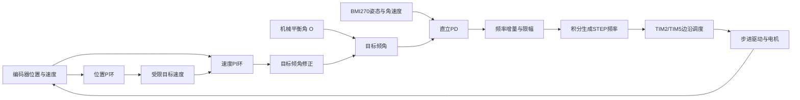

# 系统设计说明

| 属性 | 内容 |
| --- | --- |
| 文档编号 | PH-SYSTEM-CURRENT |
| 更新日期 | 2026-10-28，Asia/Shanghai |
| 适用版本 | software/firmware中的当前归集版本 |

## 1. 系统组成

STM32F407ZG完成姿态处理、编码器采样和运动控制，BMI270提供惯性数据，步进驱动器接收STEP/DIR。电脑端通过BLE完成参数设置、曲线显示及CSV记录。

当前固件使用TMC_STANDALONE_STEP_DIR=1，不依赖UART寄存器配置才能启动。驱动电流、细分和斩波模式由实际载板硬件配置决定；两侧最终板件型号及拨码电平尚需在装配清单中统一确认。

## 2. 控制结构

主循环设计周期2.5ms；速度及位置目标计算约100Hz。直立PD输出经R换算为频率增量，每10ms形成端点，再分成四个子步执行。L/S/B/H分别限制频率、常规增量和高速同向加速增量。

## 3. 引脚与接口

| 功能 | 引脚 | 当前软件实现 |
| --- | --- | --- |
| Motor1 STEP / DIR | PA6 / PA7 | TIM2中断调度PA6 GPIO，方向极性motor1Invert=false |
| Motor2 STEP / DIR | PA8 / PB0 | TIM5中断调度PA8 GPIO，方向极性motor2Invert=true |
| BMI270 SCL / SDA | PB8 / PB9 | I2C |
| 编码器1 A / B | PA0 / PA1 | 中断计数 |
| 编码器2 A / B | PB6 / PB7 | 中断计数及可信通道选路 |
| BLE串口 TX / RX | PB10 / PB11 | USART3 |

物理引脚不变，但STEP已不采用旧TIM3/TIM1 PWM机制。软件极性不替代对实际电机接线和轮向的确认。

## 4. 参数与位置原点

当前默认配置见[参数表](parameters.md)。位置环启用时捕获当时编码器位置，面板“当前位置设为回位点”重新指定原点。

位置计算仍固定平均双路累计计数，速度则可按可信编码器选路。单编码器情况下存在尺度不一致；该问题已识别但尚未修正，精确回原点仍待验证。

## 5. 验证边界

当前源码独立编译、主机逻辑回归及面板离线界面检查通过；设计脉宽、实际ISR抖动、当前默认参数下的位置保持与所有工况稳定性尚无统一验证报告。历史试验不直接替代当前版本验证。
