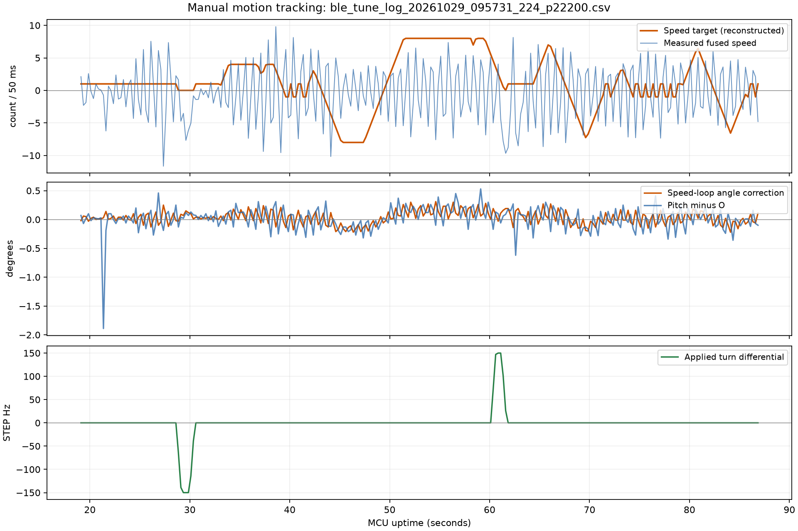

# 前后运动速度跟踪分析

分析日期：2026-10-29，Asia/Shanghai。未修改固件、控制参数或源CSV。

## 数据与方法

主记录：[09:57:31录制](../../recordings/ble_tune_log_20261029_095731_224_p22200.csv)，272行有效遥测，MCU时间19.107～86.857秒。SHA-256：`D594C3EA4D3E86AE994DAB108E37C1AD45CA94814DD0166647DE6F843BFFF472`。09:45:43记录属于此前30Hz转向版本，仅辅助核对版本变化，未混入本次统计。

CSV使用utf-8-sig读取。按代码`speedError=targetForwardSpeed-vehicleSpeed`，重建速度目标为`(speedError1000+speed1000)/1000`。目标保留整数遥测约±0.001的量化差异。通过位置目标为0、转向为0且速度目标持续不变筛选前后运动平台；这些时间是MCU上电秒数，不是按钮按下时刻。

## 已确认结果

- 重建速度目标达到+4、+8、-8，说明命令到达了速度环。手动运动平台的位置环目标为0。
- K全程-0.02、I全程0。O在21.357秒从4改为6，N在77.357秒从2改为10。参数改变区间分开对待。
- 51.607～57.857秒持续+8，融合速度均值+0.058 count/50ms，两编码器各净变化-20计数。按净计数与时间计算约+0.16 count/50ms，远小于目标+8。
- 同段平均倾角修正+0.154°，pitch-O平均+0.159°。姿态均值跟随了很小的目标变化，速度没有跟上。
- 全记录速度环修正范围-0.22～+0.31°，外环权限始终1，fallStopCount始终0。没有角度上限饱和或倒地保护触发的证据。
- 转向输出达到±150Hz。用户已确认转向可用；日志不能独立证明车体转过的角度。

| MCU时间/s | 持续速度目标 | 融合速度均值 | 平均倾角修正 | 样本数 |
| --- | ---: | ---: | ---: | ---: |
| 34.107～36.607 | +4 | -0.598 | +0.090° | 11 |
| 45.357～47.357 | -8 | +0.263 | -0.160° | 9 |
| 51.607～57.857 | +8 | +0.058 | +0.154° | 26 |

速度单位为count/50ms。样本均值与端点计数速度不同，前者受融合和振动影响，后者是区间净运动；两者在长+8平台均指向跟踪不足。个别短平台不用于证明方向异常。

## 解释与建议

当前前后运动依赖速度P误差产生倾角，没有速度积分补偿。+8且测得速度近0时，按现有K与固定速度环方向，倾角补偿约+0.16°，与遥测一致。这是本次明显的速度跟踪不足，不能直接归因于按钮、位置环或N限幅。

最有依据的下一步是仅对前后遥控增加缓慢、受限的速度误差积分或其他低频补偿，并在松手/保护时平滑退出与清理，保持驻车和转向原有参数。N先保持原2°即可；本记录没有支持继续扩大N的证据。单次只验证一个变化，固定O与速度目标并保持足够时长。

日志尚不能唯一地区分速度控制作用偏小、静摩擦/驱动余量与机械平衡点偏差。K/I合适值及最终速度跟踪必须实车验证；不据此翻转speedLoopDirection或改变SC硬件。

当前CSV没有原始按键值、manualForward.requested/applied、needsZero及超时状态。速度目标是从车端误差重建，不能还原松手、反向和故障联锁的全部过程。下一版应补充这些字段及有效速度积分项，帮助判断补偿效果。

复现：运行`software/analysis/analyze_manual_motion.py <CSV路径> <输出目录>`。原始CSV保持不变。
