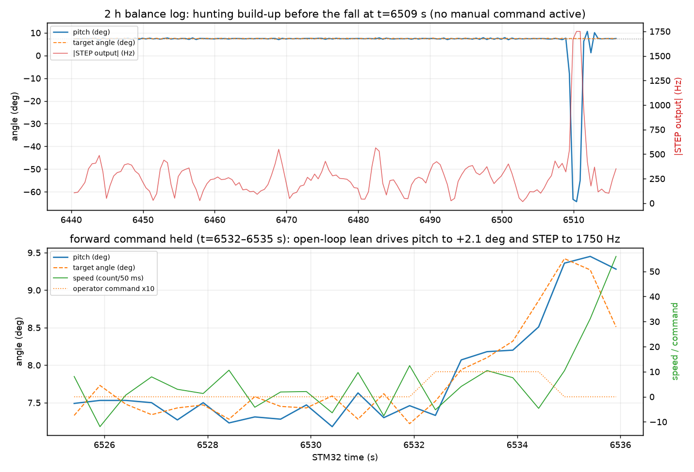

# 前后运动与平衡的冲突分析，以及运动链改造（2026-11-05）

分析对象：[2 小时长时间平衡记录](../../recordings/ble_tune_log_20261031_101235_473_p32752.csv)（6534.5 s，13032 条完整遥测，2 Hz）。
本轮改动固件源码，未烧录、未接电机；主机回归与独立编译通过。

## 1. 数据里到底发生了什么

| 时间（STM32 s） | 事件 | 关键数值 |
| --- | --- | --- |
| 10:13–11:53 | 无遥控驻车 | 姿态 RMS 偏差 0.182°，位置在 134.5～1574.5 计数间来回，始终未回到目标 |
| 6103.4–6104.4 | 前进命令 +2000 | 倾角请求 manualApplied 由 0.022° 升到 0.574°，机身 7.24°→7.92°，位置 +16 计数 |
| 6107.9–6116.9 | 后退命令 -2000 | manualApplied 到 −0.981°，机身最低 5.88°（相对 O=−1.62°），位置 1582.5→1143.5（−439 计数） |
| **6509.4–6511.0** | **无任何遥控命令时倒地** | 姿态 7.65°→−8.02°→−63.34°→−64.35°，finalHz −1750 打满，fallStopCount 0→8，位置 1569.5→−325.5 |
| 6532.4–6535.9 | 前进命令 +2000 | manualApplied 0.027°→**1.929°**，机身 7.33°→**9.45°**，速度冲到 **56 counts/50 ms**，finalHz **1750 打满** |

关键点：

1. **前后命令走的是开环倾角。** 旧代码把 `manualForward.applied`（最大 2°）直接写进 `targetBalanceAngle`，同时把速度环、位置环全部清零并 `return`
   （改动前的 `main.cpp` 3511–3518 行）。也就是说：按前进时平衡车的外环被摘掉，剩下一个"人给定的死角度"，机身必须真的压到 2° 才能走，
   轮子只能靠直立 PD 追角度。CSV 里 `target100` 与 `manualApplied` 完全同步上升，正是这个结构。
2. **只有开环这一条路是"能动"的。** 点动（jog）路径的倾角上限只有 0.30°，乘 `K=−0.02` 后实际作用约 0.02°，所以历史记录里点动基本不动；
   真正让车动的就是这条会破坏平衡的开环通道。
3. **摔倒不是命令直接造成的。** 6509 s 倒地时没有任何手动请求。倒地前 30 s 内 `balHz` 峰值从约 300 Hz 涨到 815 Hz，位置环在 ±50～70 计数、
   约 0.5 Hz 的持续振荡。开环前后运动与这个驻车极限环叠加，是这次失稳的现实背景，但 CSV 只能证明相关，不能单独归因。

## 2. 改了什么

旧链：`操作角(0..2°) → targetBalanceAngle`，外环清零。
新链：`操作角 → 归一化 → 受限速度目标 → 速度误差+摩擦前馈 → 受限倾角 → targetBalanceAngle`，外环只让位、不清零。

新增 [motion_drive.h](../../../../software/firmware/src/motion_drive.h)：

- `MotionSpeedProfile`：速度目标斜坡，上限 **5 counts/50 ms（约 100 counts/s）**，加速度 **10 counts/50 ms 每秒**（0→满速约 0.5 s）。
- `MotionLeanControl`：`lean = 0.10×v_ref + 0.05×(v_ref − v_meas)`，硬上限 **1.00°**，投入速率 2.5°/s、释放速率 3.5°/s；
  `seed()` 用当前速度环倾角做入口初值，保证进入运动时目标角不跳变。

`main.cpp` 的三处改动：

1. 手动前进/后退分支不再把 `manualForward.applied` 当角度用，只当速度指令的幅值；速度/位置环仍按原设计清零，避免双份权限。
2. 手动结束后进入释放段：速度目标与倾角都按速率回零，再交回驻车环。
3. `pitchOffset` 由 `manualForward.busy ? applied : 权限×速度环角` 改为 `权限×速度环角 + motionLean.applied`，两个通道都受同一个外环权限限制。

效果对比：

| 项目 | 旧 | 新 |
| --- | --- | --- |
| 前后运动倾角来源 | 人给的死角度 | 速度反馈闭环 |
| 最大倾角 | 2.00° | 1.00° |
| 倾角变化率 | 轨迹 2°/s、加速度 4°/s²（开环形状） | 2.5°/s（闭环，含释放 3.5°/s） |
| 速度目标 | 无 | ≤5 counts/50 ms，加速度受限 |
| 入口/释放阶跃 | 入口用 seed 平滑，释放后目标角跳回 | 入口 seed + 释放按速率回零 |
| 平衡环 | 运动期间被摘除 | 全程保留 |

## 3. 验证

- 主机回归 **9 项全过**，含新增 `run_motion_drive_regressions.py`（速度斜坡、倾角上限、方向、释放无阶跃、带静摩擦对象的闭环收敛）。
  `run_forward_regressions.py` 已按新语义更新：断言入口首拍变化 ≤ 0.025°、前进倾角 ≤1.0°、后退为负、释放后回到 `O + 速度环角`。
- 独立编译（ASCII 路径副本）：**SUCCESS**，RAM 8104 B / Flash 84388 B（改动前 8088 / 83716，+16 / +672 B）。
- 项目中文路径下 `pio run` 在链接阶段报 `cannot open map file ...`（含 CJK 的 `.map` 路径被工具链按本地代码页解析），
  与本次代码无关；绕开方式是把 `software/firmware` 复制到纯英文路径再 `pio run`，产物为 `firmware.elf/.bin`。

## 4. 上车试验建议（按顺序，每次只动一件事）

1. **先不烧**：本轮只改了运动链，直立 PD、O、K、X/Y 都没动；烧录后先在架空状态确认能编译进板、面板 `D,` 帧正常。
2. 落地后先只测**驻车** 2～3 分钟：确认位置环 ±50 计数的振荡没有被新代码改变（本轮没有动 X/Y/M）。
3. 然后单次短前进：给 `+2000` 约 1 s，观察 `target100 − O` 是否 ≤1.0°、`finalHz` 是否还打满 1750。打满说明 1° 不够，
   优先加 `MotionLeanControl::feedForwardGain`（0.10→0.14），而不是抬上限。
4. 能稳定前后各走 30～50 计数后，再测"前进→停→后退"连续换向，看释放段是否还有顿挫。
5. 已知风险：`limit=1.00°` 与 `feedForwardGain=0.10` 是从旧开环 2° 反推的经验值，没有实车标定。
   若前进仍不动，说明静摩擦大于 0.5°，需要同时提高前馈与上限，改 [motion_drive.h](../../../../software/firmware/src/motion_drive.h) 的两个常量即可。
6. 驻车极限环（0.5 Hz、±50～70 计数）本轮**未处理**，它是 6509 s 倒地的背景因素，建议下一轮单独做：
   先降 `X` 或加位置回位死区 `M`，观察振荡幅值是否收敛，再判断是否需要位置环低通。

## 5. 复现

- 分析数据：`docs/validation/recordings/ble_tune_log_20261031_101235_473_p32752.csv`（SHA256 见上一轮报告）。
- 图表脚本：`software/analysis/` 下的分段统计脚本可按 `jogActive`/`manualReq1000` 切段；本图直接按时间窗取数。
- 回归：`python software/firmware/test/run_motion_drive_regressions.py` 与同目录其余 8 个 `run_*_regressions.py`。
