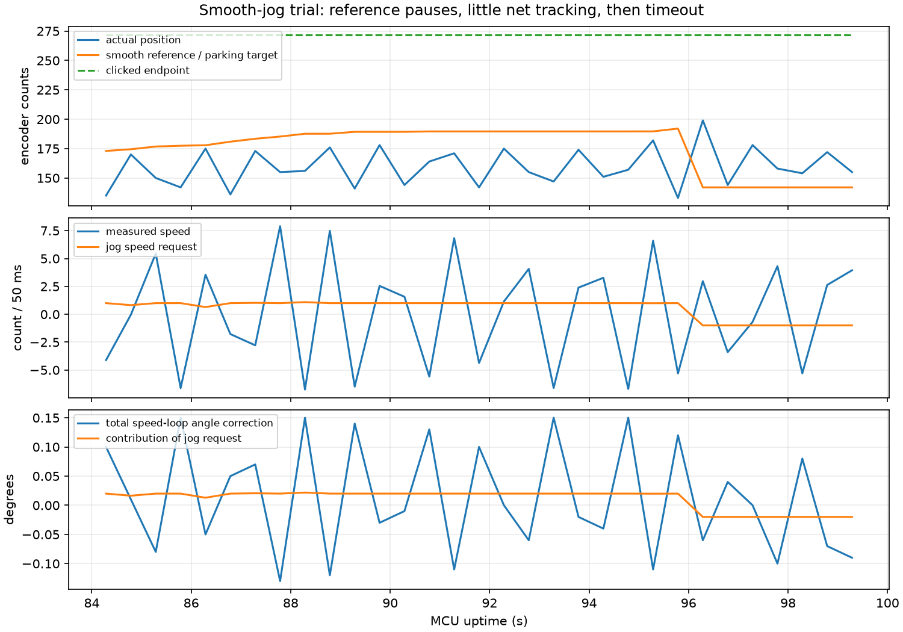

# 平滑点动实车复测分析

日期：2026-10-30，Asia/Shanghai。用户反馈：基本没有前后移动，主要晃动。

## 数据与版本

来源：[09:48:16记录](../../recordings/ble_tune_log_20261030_094816_978_p24008.csv)，300行完整遥测，3行重连/不完整记录排除；原始文件SHA256见evidence.json。新增jogGoal100与jogReferenceSpeed1000存在，说明65字段的平滑点动版本已在工作。全部使用编码器1；本次位置变化与原始编码器增量的差额最大2计数、典型为0，上一版大幅软件坐标归零未再出现。

## 结论

平滑修改已经执行，但它没有建立可靠的前后位置跟踪。9个出现活动数据的任务里，6个以12秒超时结束，1个姿态异常取消，1个心跳丢失取消，1个在日志切换到后续序号时未保留结束状态；没有到位reason=2。本次全部活动采样里，电机命令均未撞到1750Hz限制，不能靠放开L解释当前不移动。

代码把参考领先预算限制为10计数，反馈跟不上就把参考速度降到0；同时把跟踪误差钳为±10，乘0.1后只剩±1计数/50ms速度请求。以K=-0.02、speedLoopDirection=-1计算，零速度下该请求只提供±0.02°的倾角修正。位置误差继续增大也不增加这部分作用。

例如任务2323534121，24个活动采样中19个的参考速度为0，平均速度请求约+0.982计数/50ms，附加角度贡献约+0.0196°；实际位置在133～182计数之间晃动，终点272计数没有追上。图中总角度修正的正负变化主要含速度反馈阻尼，不等于面板给出了同等大小的前进倾角。

采样仅2Hz，逐行速度均值与位置差分会有采样偏差；本结论使用任务结果、参考暂停比例和代码限幅共同判断，不用单个瞬时速度判定方向。原地不动的具体物理阈值（静摩擦、机械平衡点、驱动电流等）尚未通过独立试验确认，不能仅凭CSV量化其贡献。

## 任务统计

| 序号 | 活动采样 | 参考速度为0 | 平均速度请求 | 请求角度贡献 | 最终状态 |
| --- | ---: | ---: | ---: | ---: | --- |
| 2323534117 | 12 | 8 | 0.826 | 0.0165° | 保护取消 |
| 2323534118 | 24 | 20 | -0.929 | -0.0186° | 12秒超时 |
| 2323534119 | 24 | 19 | -1.039 | -0.0208° | 12秒超时 |
| 2323534120 | 24 | 9 | 0.806 | 0.0161° | 12秒超时 |
| 2323534121 | 24 | 19 | 0.982 | 0.0196° | 12秒超时 |
| 2323534122 | 18 | 11 | 0.919 | 0.0184° | 未保留终态 |
| 2323534125 | 24 | 9 | 1.048 | 0.0210° | 12秒超时 |
| 2323534126 | 8 | 3 | -0.892 | -0.0178° | 心跳超时 |
| 2323534127 | 24 | 14 | 0.935 | 0.0187° | 12秒超时 |

速度单位为计数/50ms；角度贡献按当前K计算，未将速度阻尼项混入。数据参数列来自面板本地快照，实际速度P贡献也与K=-0.02一致。

## 后续控制调整方向

保留连续位置反馈与平滑参考，重新设计前后命令的控制作用。可用独立、受限的位置误差倾角P通道驱动位移，保留原速度反馈作阻尼，不使用积分；将运动位置作用与稳定用速度K分开调试。其限幅、斜坡和实际有效量需要独立小范围试验，不能仅从现有CSV确定一组保证能动的增益。

到位判定也需要按原地晃动幅度制定：当前±2计数且瞬时速度≤1、保持200ms可能过严。应以一段时间的位置中心和净速度判断到位，原始编码器反馈继续保留。该项不能单独解释大部分任务根本未追上终点，但会影响已接近终点的任务是否完成。

本报告不修改固件、不烧录；当前已知平滑版本仍未通过前后移动验收。
