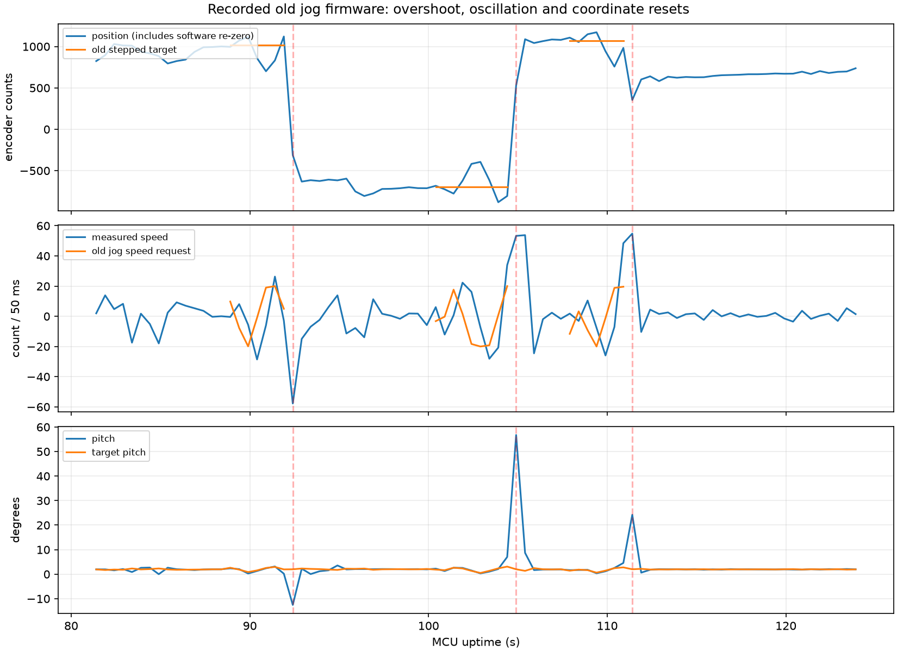

# 位置点动失稳分析与修正

日期：2026-10-30，Asia/Shanghai。分析对象为用户烧录后的旧点动版本，修正版本尚未烧录。

## 数据证据

- [ble_tune_log_20261030_091818_468_p35352.csv](../../recordings/ble_tune_log_20261030_091818_468_p35352.csv)：128行完整遥测；3行缺少点动字段，未用于点动结论。SHA256见evidence.json。
- [ble_tune_log_20261030_091958_949_p35352.csv](../../recordings/ble_tune_log_20261030_091958_949_p35352.csv)：86行完整遥测；0行缺少点动字段，未用于点动结论。SHA256见evidence.json。

最新09:19:58记录里三次点动（序号2321735576、5577、5578）均以reason=6取消，未出现到位reason=2。来源始终为编码器1（mode=1），编码器2计数为0；本段不是来源切换造成的位置跳变。

第一段终点1019计数：88.903秒时位置996，89.403秒时位置1072，半秒内已越过目标53计数；此后出现正负速度交替，92.403秒记录到姿态异常取消。其他段也有往返振荡，不能将取消后的坐标归零当成全部失稳的起因。

同一段在91.903→92.403秒，pos从1121变为-313，而enc1从-1362变为-1002。按mode=1实际位移约为-360计数，另有约-1074计数的坐标重设。这对应旧captureCurrentPositionTarget清零软件位置，不是原始编码器凭空跳变。2Hz遥测只能定位到相邻采样区间，不能证明单个控制周期的先后因果。

## 代码中确认的风险

1. 新命令直接令位置目标=当前位置±距离；只有速度斜坡，没有位置参考轨迹。连续点击又把点动速度、角度、滤波状态重置为0，造成控制切换。
2. 点动单独使用0.08角度增益，原稳定K绝对值为0.02，相当于提高4倍；同时对已有融合速度再加0.05低通，100Hz下时间常数约195ms，增加相位滞后。这是失稳的强嫌疑，CSV不能单独量化各项贡献。
3. 到位/停止/异常取消会重置软件里程坐标；旧点动结束还直接清零角度修正。这会造成遥测跳变和控制交接突变。

较早09:18记录在首次点动前也有O参数调整与大姿态偏离，不能将该文件所有异常归因于点动。最新文件的点动段提供更直接的对应证据。fallStopCount始终为0只表示倒地保护未计数，不代表车体没有异常姿态。

## 当前修正

- 原始编码器与累计里程保持连续；驻车捕获只改变驻车参考，不改累计位置。
- 终点与控制参考分离。参考速度/加速度受限；100Hz下参考位置每周期变化不超过0.6计数，反向与重复设目标不重置轨迹状态。反馈跟不上时按领先距离减速。
- 点动复用原K/N速度环，去掉0.08私有增益与额外速度低通；点动不使用I。位置前馈与小幅跟踪校正共同生成有界速度目标。
- 点动与驻车共享目标速度斜坡，停止/到位/取消交接不直接清零角度修正。实际电机停机故障仍允许保护立即停机。
- 遥测新增终点与参考速度，区分点击终点、缓变参考和真实反馈。单次12秒超时、500ms心跳、5°姿态取消继续提供退出边界。

## 验证边界

真实main.cpp片段回归验证原K速度反馈、参考缓变、反向/停止交接与里程连续性；控制器测试覆盖理想跟踪和编码器停滞。理想跟踪器不是平衡车动力学模型，不能保证实车稳定。编译通过后仍需从短距离、有防倾倒措施的实车测试验证，不能从本次代码修改宣称已解决失稳。
