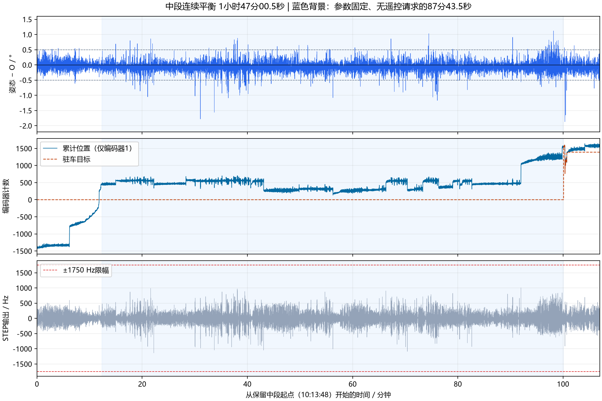

# 2026-10-31 长时间平衡记录分析

分析日期：2026-10-31，Asia/Shanghai。按用户说明，中间为已平衡状态；本报告剔除开始与结束，不用末尾搬动/大角度变化反推中段自行失稳。仅分析，未修改固件、面板和参数，未烧录。

## 统计窗口与平衡时间

原记录约108分54.5秒（STM32 ms时间）；主机时间跨度108分54.27秒。采用STM32时间计算时长，避免蓝牙收包抖动。共13039条解析记录，13032条完整记录，7条缺列/多列/缺值记录排除。原CSV完整保留，不覆盖、不删行。

- 主分析保留10:13:48.353～12:00:48.733，STM32相对首样本60.0～6480.5秒：**1小时47分00.5秒**，12842个完整采样，最大采样间隔500ms。保守去掉开头60秒调参/过渡，以及相对6481秒开始的尾部大姿态变化和后续操作；保留中间所有有效样本，不按姿态大小再次挑选好数据。起止边界约有一个0.5秒采样间隔的不确定性。
- 参数固定且没有遥控请求/运动输出、驻车目标也固定的子段为10:26:10.886～11:53:54.123：**87分43.5秒**，10528个采样。末尾截在首次驻车目标重捕获之前（相对6066.5秒），而不是等面板首次非零转向请求出现才截取。
- 11:53:55附近以后包含前后/转向测试，中间仍平衡，但不能将整段107分钟称为全程无人操作。CSV不能独立证明无人扶车；持续平衡状态按用户现场说明解释。
- 结尾相对6481秒出现大偏角、随后fallStopCount从0变8，全部排除。该计数是保护触发累计，不能理解成8次独立摔倒，无法仅凭CSV断言是自发失稳或人为收车。

## 直立表现

| 指标 | 中段107分00.5秒 | 固定参数无遥控87分43.5秒 |
| --- | ---: | ---: |
| 姿态相对O的均方根偏差 | 0.182° | 0.182° |
| 距O不超过±0.5°的采样 | 98.68% | 98.61% |
| 距O不超过±1°的采样 | 99.88% | 99.90% |
| 姿态相对O最小～最大偏差 | −1.87°～+1.12° | −1.78°～+1.12° |
| 最终STEP输出最小～最大 | −1138～+1009Hz | −1138～+1009Hz |
| 最终输出达到±1750Hz的采样 | 0 | 0 |
| 倒地保护计数增加 | 0 | 0 |

这些数据支持中段长期直立稳定，没有证据需要先大幅重调直立P/D。最终输出2Hz采样没有打满，不等于证明采样之间绝无短促限幅。原始直立输出窗口峰值最高3613Hz，中段约1.07%的窗口超过1750Hz；它是进入后续约束前的原始需求，不能当成电机实际收到3613Hz，也不能仅凭尖峰判失步。晃动及控制动作仍存在，持续平衡不等于车体完全不动。

## 主要问题：驻车位置长期偏离

无遥控子段里，驻车目标一直为0，位置环始终启用；累计位置从435.5变成1535.5计数，净变化**+1100计数**，范围134.5～1574.5计数，整个子段没有回到目标。两路来源字段均为1，即仅使用编码器1。

这是比姿态更突出的误差。它不证明车的实际厘米位移，因为轮径、每转计数与地面打滑没有在本次标定。不能把这段平衡解读为精确原地驻车，也不能凭单路编码器证明两个电机都没有失步。

位置回位速度请求在这10528个样本中**100%达到Y=1.5计数/50ms上限**。因此继续增大位置P参数X=5，不能让已经饱和的回位请求再变强。无速度积分（I=0）时，K=−0.02对应位置回位请求能额外提供的稳态目标角量级最多为**|K|×Y=0.03°**；实际速度反馈仍会另行产生修正，不能把0.03°误说成整个速度环输出上限。

这说明位置目标正确保留、位置环在请求回位，但有效回位权能有限。小的平衡角偏置、摩擦/地面差异、测量偏置或单路编码器误差都可能产生长期偏离，现有日志不足以唯一归因。固定O=7.5°期间平均俯仰约7.435°，这0.065°差异提示可单独核对平衡点，但不能仅据平均差直接把O改成7.435°。

## 参数与调试重点

固定参数子段：P=1000，D=100，O=7.5°，K=−0.02，I=0，N=2°，X=5，Y=1.5计数/50ms，M=0；L=1750Hz，S=100，B=1000，H=40，R=0.1。编码器来源1。该组是本次记录的实际参数快照，不是旧O=4°默认值。记录早段短暂出现K=−0.04/−0.06，分别仅8.5/11.5秒，不能据此认定更大K长期稳定。

建议保留这组直立P/D作为长时间平衡基线，下一步单独处理驻车：先在同一地面和载荷下核对O及编码器方向/尺度，再评估回位速度上限Y与速度环的回位权能，逐项比较位置误差是否实际收敛。此次不直接开启积分或提高多个增益。前后遥控性能需要单独分析运动片段，不与87分钟驻车数据混算。

## 复现与来源

[原始CSV](../../recordings/ble_tune_log_20261031_101235_473_p32752.csv)。SHA256：`c6a9a62188907e5cb9beb52212508d303dc5cd2adf65a8ac523d03bd220a137a`。

[统计结果](metrics.json)包含精确窗口、样本数、间隔、分位数和参数固定段驻车指标。仓库根执行software/analysis/analyze_long_balance.py可复现数值分析，输入按utf-8-sig读取。图中蓝色背景对应固定参数、无遥控子段，未画入已剔除首尾。
