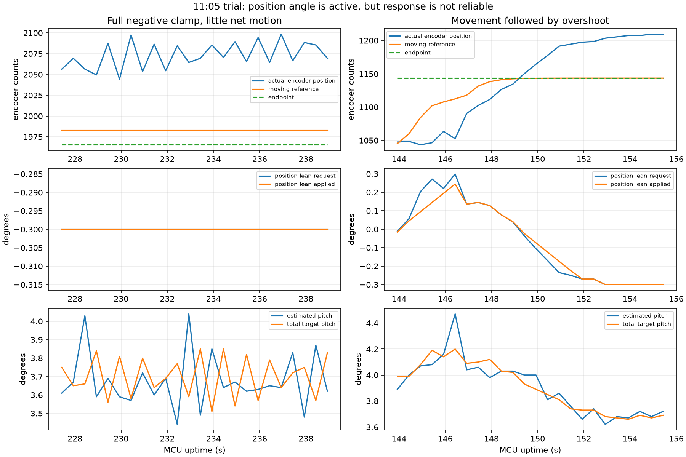

# 位置环作用强度与公开平衡车控制源码对照

分析时间：2026-10-30，Asia/Shanghai。本轮仅分析，不改固件、不烧录。

## 结论

新增位置倾角已经起作用，当前主要可见限制是倾角上限及建立速度，不能只归为位置P太小。默认P=0.005°/计数、上限0.30°，误差达到60计数就饱和，继续增加P不会突破该上限。日志已出现整段输出-0.30°仍追不上目标的情况，也出现位置越过终点的情况；当前控制尚未通过移动与制动验收。

## 最新CSV证据

来源：[11:05记录](../../recordings/ble_tune_log_20261030_110500_147_p28076.csv)。完整遥测635行、排除重连/不完整记录3行；原始SHA256和逐任务统计见evidence.json。

17个有活动采样的序号中：3个任务超时、5个心跳取消、1个保护取消；8个切换到后续序号时旧序号未保留终态，不作为完成任务统计；无到位事件。连续重设终点和心跳取消会干扰辨识。以下选取完整超时段提供判断依据。

- 序号2328137167：227.431～238.931秒的24个活动采样，位置倾角请求和实际输出全部为-0.300°。终点1965.5计数，位置由2056.5到2069.5，范围2044.5～2098.5，没有向后达到目标。软件位置通道没有被速度环完全消除；总目标角均值约3.699°，估计俯仰均值约3.676°。这些是姿态估计量，不等于外部测量的真实车身倾角。
- 序号2328137162：记录到位置由1047.5到1209.5，越过1143.5终点66计数，后半段位置倾角变负并到-0.30°，仍未到位。CSV不能区分全部自主位移与人工干预，但不能把本文件概括为完全没有位移。
- 默认建立速率0.10°/s，0升到0.30°至少需3秒。较早一段的请求均值约0.177°，实际输出均值约0.102°，限速也在削弱短任务的有效作用。

## 平衡点已由用户确认

本次O参数快照为4°，由总目标角与修正反推的车端O也约4°；上一份09:48记录为约2°。相差2°，超过位置倾角上限0.30°的6.7倍。用户已明确说明4°是重新调过后本次使用的平衡点，因此按4°作为本轮基线，不把它列为默认值恢复或失效根因。两份日志的平衡点不同，比较时仍需注明这一条件。

## 公开实现怎么做

| 实现 | 运动链路 | 与本项目的区别 |
| --- | --- | --- |
| B-ROBOT EVO2，步进电机 | 位置PD生成目标速度，速度PI生成目标倾角，直立PD输出累加为电机速度 | 位置单位为发送STEP计数，速度主要由电机步频和体转角变化估算；不是同一STM32/编码器链路。正常模式倾角硬上限14°，不是建议本车直接设14°。 |
| EduMiP rc_balance，直流编码器电机 | 连续更新轮角参考，离散位置控制器D2生成目标倾角，再进D1内环 | 先把编码器换成绝对轮角并补偿车体角；倾角输出限幅0.33rad约18.9°。硬件与控制器量纲不同。 |

公开方案说明移动靠完整的位置/速度反馈链生成倾角，输出限幅与环路带宽都是设计量。P数值不能跨步数、编码器计数、轮角、速度和倾角输出单位直接比较。B-ROBOT使用速度积分，但这不证明本车必须使用I；独立位置P与速度阻尼仍可作为无I方案调试。

公开源码来源（2026-10-30检索）：
- [B-ROBOT EVO2 main](https://github.com/jjrobots/B-ROBOT_EVO2/blob/master/Arduino/BROBOT_EVO2/BROBOT_EVO2.ino)，检查符号：positionControlMode, positionPDControl, speedPIControl, stabilityPDControl, MAX_TARGET_ANGLE。
- [B-ROBOT EVO2 control](https://github.com/jjrobots/B-ROBOT_EVO2/blob/master/Arduino/BROBOT_EVO2/Control.ino)，检查符号：positionPDControl, speedPIControl。
- [EduMiP rc_balance](https://github.com/beagleboard/librobotcontrol/blob/main/examples/src/rc_balance.c)，检查符号：setpoint.phi, setpoint.phi_dot, D2, setpoint.theta。
- [EduMiP definitions](https://github.com/beagleboard/librobotcontrol/blob/main/examples/src/rc_balance_defs.h)，检查符号：THETA_REF_MAX, D2_NUM, D2_DEN。

## 下一轮验证建议

1. 使用用户已调好的O=4°，在一次试验内固定O、K、I及电流/细分。I继续保持0。
2. 对于已经长时间饱和的段，优先比较倾角上限0.30→0.40→0.50°；P先固定0.005。均在现有面板合法范围内。每次只发一个短距离任务，记录真实倾角、目标倾角、位置中心和净位移。此步是辨识试验，不保证提高上限就解决。
3. 若0.50°仍能在估计角度中跟踪、实际净位移仍近零，继续检查实际俯仰校准、车轮接触/滚阻、STEP/编码器量纲和内环执行链；现有CSV无法独立确认这些因素。
4. 对有明显位移的工况，先核对方向与制动响应，再评估是否提高位置P/加快建立速度；避免用更大P同时掩盖起动弱和制动不佳。心跳取消需先排除，才能判断完整任务成败。

本轮没有从他人代码复制控制参数，也没有把其角度上限当作本车目标。当前原固件保持不变，后续需要受控实车验证。
