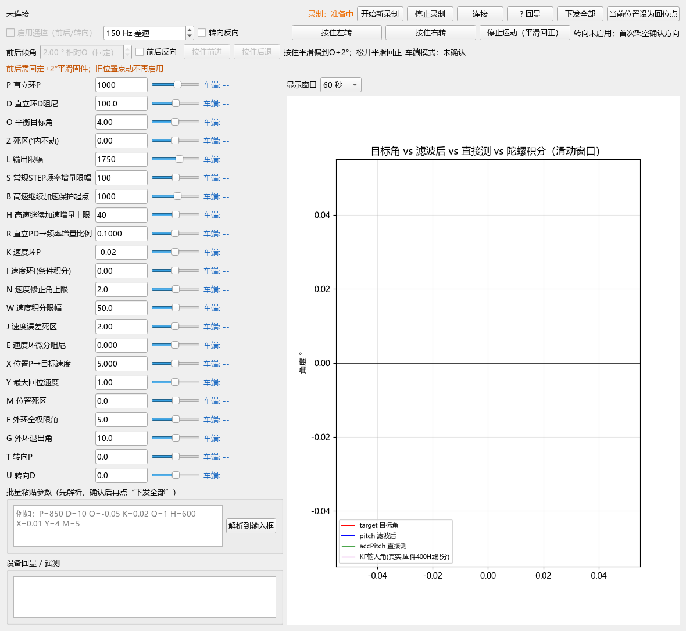

# 当前蓝牙调参面板

更新日期：2026-10-30，Asia/Shanghai。

源码、启动器和依赖位于本目录。Windows入口为ble_tune_panel.bat或仓库根open-panel.bat。22项默认配置见[当前参数表](../../docs/parameters.md)。新CSV写入docs/validation/recordings，旧记录在history/data/raw。本机.venv和device.local.bat由Git忽略，新电脑安装见[运行说明](../../GETTING_STARTED.md)。

截图为 2026-10-30 的离线构造，未连接 BLE、未生成实车波形；前后区当时仍是旧的固定倾角控件。2026-11-06 起该区改为
“前后速度”档位 + 车端倾角/实测速度显示，图片尚未重拍（离屏渲染缺字体，不做假图）。

遥控采用按住左/右转与按住前进/后退。默认差速150Hz，可调5～300Hz。前后是**速度档位**（0.5～2.0，默认满档 2.0），车端按 `档位/2×5 counts/50ms` 换算速度目标，倾角由速度闭环生成并限制在 1° 以内，不再是固定倾角。松开后速度指令回零、倾角按速率释放，再交回驻车环。面板显示档位、实测速度、车端倾角（`target100−O`）和速度环恢复比例。

前后需 2026-11-05 之后的固件：PAR 回显必须含 `MOTION=2`。旧固件的 `MOVE=5 SMOOTH=1` 是开环死倾角，接口数值含义不同，面板会保持禁用并提示"旧开环倾角固件"。连接后收到实时遥测才启用；按住期间持续发送请求，失焦、关闭、断线和遥测超时撤销请求。停止按钮撤销两轴。当前源码未烧录，实车效果待验证。

CSV兼容49/56/57/63/65/71/74个数值项，新增手动角变化率、阶段和正常环恢复比例。旧位置倾角版本及配置确认测试归档到history/software/ble-panel/2026-10-30-position-angle，保留历史实测追溯。
