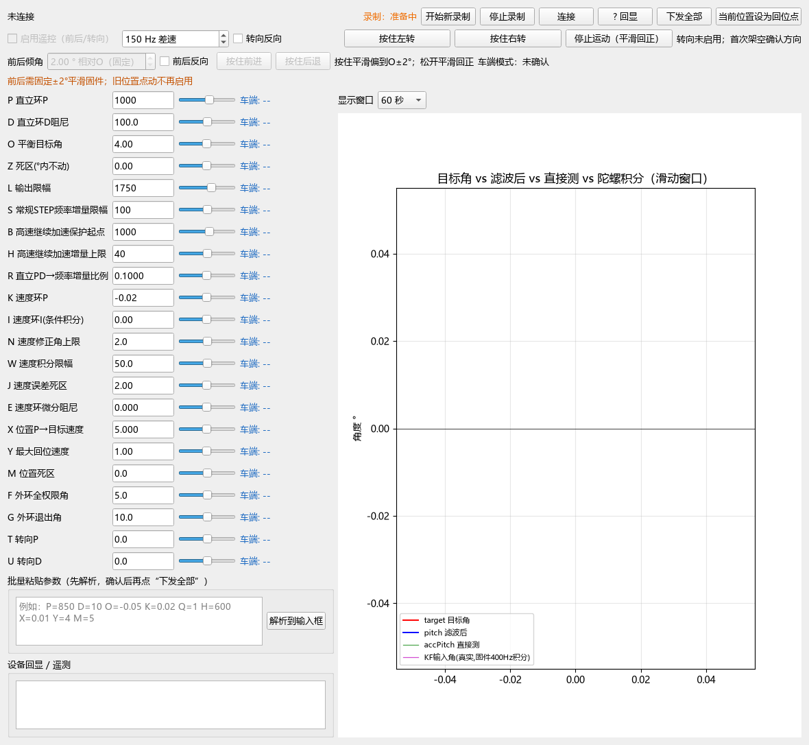

# 当前蓝牙调参面板

更新日期：2026-10-30，Asia/Shanghai。

源码、启动器和依赖位于本目录。Windows入口为ble_tune_panel.bat或仓库根open-panel.bat。22项默认配置见[当前参数表](../../docs/parameters.md)。新CSV写入docs/validation/recordings，旧记录在history/data/raw。本机.venv和device.local.bat由Git忽略，新电脑安装见[运行说明](../../GETTING_STARTED.md)。

截图来自当前程序的离线构造，未连接BLE，未生成实车波形。

遥控采用按住左/右转与按住前进/后退。默认差速150Hz，可调5～300Hz；前后固定相对O ±2°，输入框只读。松开前后平滑回O，再渐渐恢复速度环。面板显示实际请求、平滑输出、变化率和速度环恢复比例，不再提供旧位置P与上限应用按钮。详见[控制说明](../../docs/turning.md)。

前后需新固件`MOVE=5 SMOOTH=1`，连接后收到实时遥测才启用。MOVE=3/4不启用新前后操作。新固件需重启面板，按住期间持续发送请求；失焦、关闭、断线和遥测超时撤销请求。停止按钮撤销两轴。当前源码未烧录，实车效果待验证。

CSV兼容49/56/57/63/65/71/74个数值项，新增手动角变化率、阶段和正常环恢复比例。旧位置倾角版本及配置确认测试归档到history/software/ble-panel/2026-10-30-position-angle，保留历史实测追溯。
